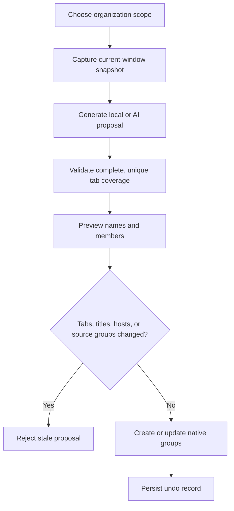

# Qiye 1.3.0

**English** | [简体中文](./README.zh-CN.md)

> Continuously organize Chrome tabs from a side panel, rebuild existing groups when needed, and release background page contents by group—without removing the tabs, names, colors, or positions you rely on.


Maintainer: iTang

> [!IMPORTANT]
> Qiye is **source-available for noncommercial use only**. Commercial use requires prior written permission from the copyright holder. See [License](#license).

## Why Smart Tab Organizer became Qiye

Version 0.13.2 could already turn a crowded window into native Chrome tab groups. Long-term, real-world use exposed two deeper problems.

### Pain point 1: “Already organized” does not mean “never reorganize again”

In one actual session, the window contained 81 tabs but the old default scope reported only 4 as eligible. The reason was intentional: the safe mode protected existing manual groups and only included new tabs plus groups that the extension could identify as its own.

That protection is useful, but users can have two different intentions:

1. **Continue organizing**—keep manual groups and process only new tabs plus Qiye-owned groups.
2. **Reorganize everything**—rebuild all processable tabs in the current window, including existing manual groups.

Version 1.3.0 stops guessing. The scope must be chosen explicitly before the first real organization, can be changed later, and is included in preview validation, failure rollback, and undo metadata.

### Pain point 2: users want to keep tabs, but Chrome may not release them promptly

Tab groups solve findability, not memory retention. A real diagnosis behind this project observed:

- 24 GB of physical memory;
- about 21.13 GB reported as used;
- roughly 102 Chrome processes and 93 renderer processes;
- an estimated 16.2 GiB resident set across the Chrome process group;
- many background tabs at almost zero CPU while still retaining hundreds of megabytes of page state.

Chrome's built-in Memory Saver is delayed and heuristic. It does not mean “release this project group now.” Closing the tabs immediately would destroy the organized work context.

Qiye therefore adds a second peer module: **manually discard background page contents by native tab group while preserving each tab, group, title, color, and position.**

## Real-world screenshots

These images come from an installed extension and real Chrome windows. Public documentation keeps the extension surface while excluding API keys, account email addresses, full browsing history, and operating-system usernames.

### Live 1.3.0: 90 tabs, with full reorganization selected

<p align="center">
  
</p>

This image was captured from the currently installed 1.3.0 build on 2026-10-23:

- 90 tabs in the current window;
- Tab Organizer and Memory Management are peer modules;
- the active scope is Reorganize Everything;
- local rules and user-provided AI remain available;
- the primary action clearly states “Reorganize all 90 tabs”;
- preview, data disclosure, and review diagnostics remain accessible.

Only extension views were switched while capturing the image. No tab was organized, released, or otherwise changed.

### Explicit scope selection

<p align="center">
  
</p>

This is the direct answer to the real “81 tabs, only 4 eligible” report:

| Mode | Included | Protected |
|---|---|---|
| Continue Organizing | New and ungrouped tabs plus safely identified Qiye groups | User-created manual groups |
| Reorganize Everything | Every processable tab, including manual-group members | Pinned, split-view, and unsupported pages |

Reorganize Everything is not a hidden switch. The UI explains that existing groups will change and requires an explicit confirmation. Its undo behavior depends on those groups not being changed again beyond safe recognition, so it is not a substitute for a complete session backup.

### Real memory-release result: 82 background tabs released

<p align="center">
  
</p>

This image came from an actual trial of the memory module:

- 84 tabs in the current window;
- 83 reported as discarded;
- 1 protected;
- the most recent operation released 82 background tabs;
- tabs, groups, and positions remained unchanged.

The memory module began as the 0.14.0 experiment, was refined through 0.15.x and 1.0–1.2, and remains the same guarded operation in 1.3.0. A second live check of the current 1.3.0 build on 2026-10-23 found **90 tabs: 88 discarded, 2 protected, and 0 still eligible for release.**

This proves that the discard operation ran and the tab structure remained intact. It does not prove an exact number of gigabytes saved. Browser restarts, macOS compression and swap, page activity, and Chrome's own policies also affect system memory.

## Core capabilities

| Module | Capability |
|---|---|
| Tab Organizer | Local rules or user-provided AI create native Chrome groups |
| Organization scope | Explicit Continue Organizing / Reorganize Everything choice stored locally |
| Preview | Generates a read-only plan and rechecks tabs plus source groups before apply |
| Safe undo | Multiple records, restart-aware matching, transactional rollback, manual-group restoration |
| Memory Management | Inspect and release background pages by group or by individual tab |
| Release protection | Skips active, pinned, audible, discarded, loading, split-view, PDF, and special pages |
| Side panel | A durable surface for long lists and repeated work |
| Popup | Optional compact presentation with a one-time “open side panel” action |
| First-run tour | Spotlight guidance for scope, method, execution, memory, and settings |
| Appearance | System, light, and dark themes stored locally |
| About | Version, author, repository link, and replay-tour control |

## Product principles

### Native output, not a second tab system

Organization results are native Chrome tab groups. After the extension interface closes, group names, colors, order, and Chrome's built-in interactions remain available.

### The user chooses intent; Qiye prevents unsafe execution

The number of eligible tabs is not presented as an unavoidable technical fact. It follows the selected scope. Once the user chooses intent, Qiye:

- captures the current eligible range;
- records source-group membership for full reorganization;
- validates tab IDs, titles, hostnames, and source groups before apply;
- rejects stale previews;
- restores already-moved tabs if a later group fails;
- enables undo only when the current state can still be matched safely.

### Only report memory states the extension can verify

Qiye reports:

- eligible tabs;
- already discarded tabs;
- protected tabs;
- success, skip, and failure counts with reasons.

It does not report per-tab megabytes, exact gigabytes saved, a browser-wide pressure score, or an invented “performance problem” percentage.

## First use

1. Click the Qiye toolbar icon. The side panel opens by default.
2. Follow the spotlight tour through scope, organization method, direct/preview actions, memory management, and settings.
3. Before the first real organization, choose:
   - **Continue Organizing** for the conservative path that preserves manual groups;
   - **Reorganize Everything** to rebuild all processable tabs.
4. Choose Local Rules or AI.
5. Organize directly or preview first.
6. Open Memory Management and select background groups that should remain findable but do not need to stay loaded.

Skipping the tour never selects a scope or performs an operation. The tour can be replayed later from About.

## Installation and update

### First installation

1. Open `chrome://extensions`.
2. Enable **Developer mode**.
3. Select **Load unpacked**.
4. Choose the `qiye-sidepanel-trial` directory containing `manifest.json`.
5. Chrome displays “Qiye · Tab Organization and Memory Management.”

Minimum version: Chrome 140.

The historical directory name `qiye-sidepanel-trial` does not mean the current product is still a trial build.

### Updating from 1.1 or 1.2

If Chrome already loads this directory, use **Reload** on the existing extension card to preserve its extension ID and local settings. Moving the loaded directory may cause Chrome to assign a different extension ID.

### Migrating from Smart Tab Organizer 0.13.2

Qiye is the successor product line with a newer Chrome baseline, additional permissions, and a different presentation model. A parallel validation is safer than overwriting the old directory:

1. Keep the 0.13.2 folder and extension card.
2. Load 1.3.0 as a separate unpacked extension.
3. Validate Continue Organizing first.
4. Test memory management on reload-safe pages.
5. Remove the older extension only after settings and undo behavior are understood.

Local settings do not migrate automatically across different extension IDs.

## Tab organization in detail

### Local rules

- fully on-device;
- no API required;
- uses title, domain, repeated project names, and topic terms;
- favors predictable, low-cost daily organization.

### AI mode

- uses a user-configured Chat Completions-compatible endpoint;
- supports cross-site project recognition;
- locally repairs high-confidence omissions, hosted-domain mistakes, and overly narrow names;
- may make one additional scoped review call when uncertain tabs remain.

### Preview and apply



Full reorganization records the original group for every moved tab. If a later operation fails, already-moved tabs are returned to surviving source groups where possible and the partial outcome is reported.

## Memory management in detail

### What release means

Qiye asks Chrome to unload a background page while retaining:

- the tab;
- its native group;
- group name and color;
- tab position.

Activating the tab again causes Chrome to reload the page.

### Workflow

1. Open **Memory Management**.
2. Review Eligible / Discarded / Protected counts.
3. Switch between Pending and All Groups.
4. Select a whole group or expand it for individual choices.
5. Use Select All / Clear when appropriate.
6. Choose **Release N tabs**.
7. Review released, skipped, and failed results.

Nothing is preselected. Opening the page cannot accidentally release a group.

### Per-tab protection

Each target is fetched and checked again immediately before execution. Qiye skips:

- the active tab;
- pinned tabs;
- audible tabs;
- already discarded tabs;
- tabs with `autoDiscardable === false`;
- loading or pending-navigation tabs;
- split-view tabs;
- PDFs;
- non-HTTP(S) pages.

Extensions cannot reliably detect every unsaved form, Picture-in-Picture state, or device-capture session. The interface therefore keeps a visible warning: **the tab remains, but reopening reloads the page and unsaved content may be lost.**

### Why there is no “undo release” button

Discarding page memory is not the same as moving a tab between groups. The honest recovery path is to activate the tab and let Chrome reload it. That cannot restore every in-memory form or temporary state, so Qiye does not offer a misleading transactional undo.

## Evidence and measurement limits

Two forms of real-world evidence were observed:

1. large sets of tabs moved from eligible to Chrome-reported discarded state;
2. later Chrome Task Manager checks no longer showed the previous collection of renderer processes that each held hundreds of megabytes, while macOS memory pressure returned to green.

This was not a controlled benchmark. One observation moved from about 21.13 GB used to about 10.7 GB, but Chrome process IDs changed in between. Browser restart, macOS compression/swap, and Chrome's own policy may all have contributed. The supported claim is therefore narrower and defensible:

- manual discard really executed;
- Chrome tab state verified the result;
- tabs, groups, and positions remained;
- the entire system-memory change cannot be attributed to the extension.

## Side panel, popup, and appearance

- toolbar action opens the side panel by default;
- Settings can change the default to popup;
- the popup can open the side panel temporarily;
- both surfaces share the same business script;
- Chrome controls whether the side panel appears on the left or right;
- appearance supports system, light, and dark modes;
- opening the HTML file directly shows a disabled sample and never reads real tabs.

## AI data and privacy

AI mode sends only the title, hostname, normalized site identifier, and temporary ID of tabs inside the selected organization scope.

- Continue Organizing excludes manual-group members.
- Reorganize Everything includes the titles and hostnames of processable manual-group members.
- Pinned and unsupported pages are never included.
- Full URLs, query parameters, and page bodies are not sent.

API endpoint, model, and key are stored in `chrome.storage.local`. They do not sync through the Chrome account, and local storage is not an encrypted credential vault. Memory management is fully local and never calls AI.

## Permissions

| Permission | Purpose |
|---|---|
| `tabs` | Read tab state, create groups, and request background-page discard |
| `tabGroups` | Create, inspect, name, and color native groups |
| `storage` | Store preferences, scope, tour state, correction memory, undo, and operation journals |
| `contextMenus` | Provide an entry point that respects side-panel/popup preference |
| `sidePanel` | Host a persistent Chrome-native side panel |
| Optional host access | Requested only for the AI endpoint explicitly configured by the user |

## Architecture

```text
qiye-sidepanel-trial/
├── manifest.json             # MV3, Chrome 140, side panel and permissions
├── background.js             # Organize, preview, undo, discard and locking
├── core.js                   # Local grouping, AI validation and topic repair
├── performance-core.js       # Eligibility, protection reasons and aggregation
├── ai.js                     # Endpoint, model discovery, test and requests
├── undo-state.js             # Persistent snapshots and safe restart matching
├── theme-init.js             # Theme before first paint
├── popup.html                # Shared popup/side-panel structure
├── sidepanel.html            # Chrome side-panel entry
├── popup.css                 # Responsive presentation for both surfaces
├── popup.js                  # Scope, tour, theme, organization and memory UI
├── icons/
├── test/
├── DESIGN.md
└── README.md
```

### Concurrency and recovery

Organization, preview apply, undo, and memory release coordinate per window so they cannot mutate the same tab set concurrently.

Memory release is itemized:

- state is checked again for each target;
- one failure does not cancel the whole batch;
- results are separated into released, skipped, and failed;
- a session journal allows a reopened UI to explain an interrupted or partially completed operation.

## Development and verification

No build tool or third-party test framework is required:

```bash
npm test
```

Verified while preparing this documentation:

```text
tests 64
pass  64
fail  0
```

In addition to the 0.13.2 organization, AI, preview, and undo suite, 1.3.0 covers release policy, protection reasons, group aggregation, peer-module structure, disabled direct-file preview, side-panel/popup parity, appearance state, first-use scope selection, spotlight guidance, full reorganization, source-group invalidation, rollback, and manual-group restoration.

## Evolution from 0.13.2 to 1.3.0

| Version | Key change |
|---|---|
| 0.13.2 | Mature native grouping, preview, persistent undo, compact settings |
| 0.14.0 | Separate experiment for grouped background-page release |
| 0.15.0 | Organizer and Memory Management became peer modules |
| 0.15.1 | Clear pending/all filters, no default selection, less copy |
| 1.0.0 | Unified Qiye identity and production information hierarchy |
| 1.1.0 | Side panel, popup preference, shared interaction layer |
| 1.2.0 | System/light/dark appearance, About, author and repository |
| 1.3.0 | Dual scope, explicit confirmation, source-group validation, tour, compact metrics |

## Legacy documentation

The detailed Smart Tab Organizer 0.13.2 documentation is preserved under [`docs/legacy/0.13.2/`](./docs/legacy/0.13.2/README.md) in the combined repository.

## Known limits

- Only the current window is processed; native Chrome groups cannot span windows.
- Reorganize Everything changes existing manual groups and should be previewed first.
- Undo is a safe best effort, not a full session backup.
- Discarding a page may lose unsaved page state.
- Extensions cannot reliably detect every form, PiP, or capture state.
- Qiye does not estimate per-tab memory or gigabytes saved.
- Chrome versions below 140 cannot expose all required split-view state.
- Chrome decides the side-panel position.
- Local and AI grouping can both misclassify content.

## License

Copyright © 2026 iTang.

Qiye is provided under the [PolyForm Noncommercial License 1.0.0](./LICENSE). You may use, study, modify, and redistribute it for permitted noncommercial purposes, subject to the full license terms and preservation of the required notices.

Commercial use is **not granted** by the repository license. This includes use in paid products or services, revenue-generating deployments, commercial client work, and internal business workflows. Obtain separate written permission from the copyright holder before any commercial use.

This is a **source-available** project, not OSI-approved open-source software. If this summary conflicts with the `LICENSE` file, the `LICENSE` file controls.

## Before publishing

- [ ] Keep `README.md` as the default English entry and `README.zh-CN.md` as the linked Chinese version.
- [ ] Keep relative screenshot paths intact.
- [ ] Add a standalone privacy policy for organization metadata, AI transfer, local key storage, and memory management.
- [ ] Run clean-profile, multi-window, restart, and 100+ tab regression tests.
- [x] Add the PolyForm Noncommercial 1.0.0 `LICENSE` and clearly identify the project as source-available.
- [ ] Add issue, support, release, and Chrome Web Store links.
- [ ] Recheck screenshots for account names, full URLs, API keys, browsing history, and OS usernames.

## Screenshot authenticity

- The first two images were captured from the currently installed 1.3.0 build on 2026-10-23.
- The third image records a real memory-module trial using Chrome-reported tab states.
- No generative image was used to fabricate product UI.
- Screenshots containing a GitHub account page, full tab-title list, Activity Monitor username column, or API configuration were excluded.
- Real-world data demonstrates workflow and observed outcomes, not a cross-device performance guarantee.
