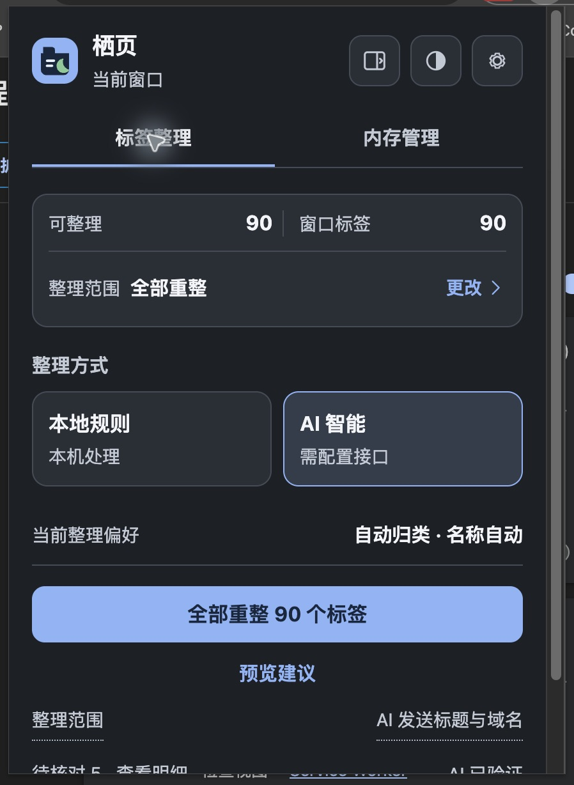
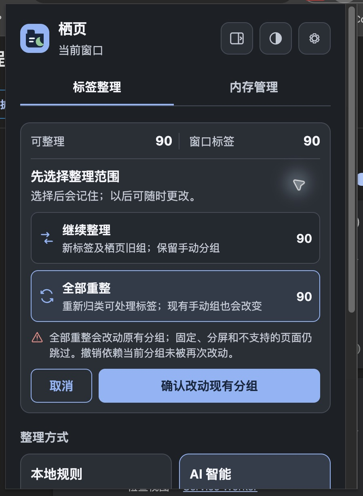
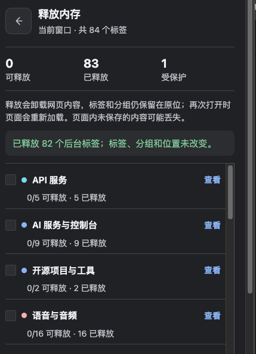
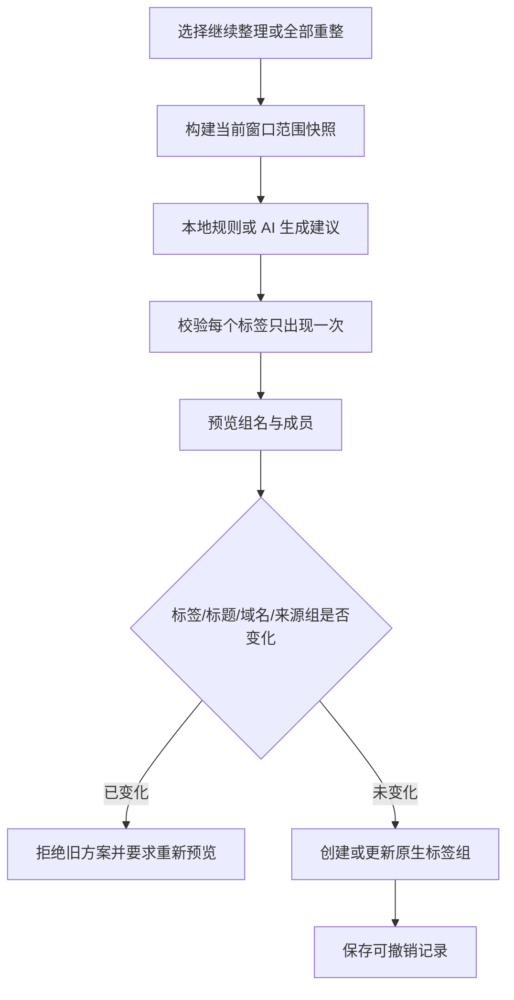

# 栖页 1.3.0

[English](./README.md) | **简体中文**

> 在 Chrome 侧边栏里持续整理标签、重新规划现有分组，并按组释放暂时不用的后台页面——标签、组名和位置仍然保留，需要时再打开。


维护者：iTang

## 为什么从“智序标签”升级成“栖页”

0.13.2 已经能把大量标签整理成 Chrome 原生分组，但长期真实使用暴露出两个更深的问题。

### 痛点一：标签已经整理过，不代表以后不需要重新规划

一次真实使用中，窗口里有 81 个标签，但旧逻辑只显示 4 个可整理标签。原因是默认策略会保护现有手动分组，仅处理新标签和扩展能够安全识别的旧组。

这个保护逻辑本身是正确的，但用户实际存在两种不同意图：

1. **继续整理**：保留手动分组，只处理新标签和栖页旧组；
2. **全部重整**：不管之前是否分过组，重新规划当前窗口所有可处理标签。

1.3.0 不再猜测用户意图。首次真正整理前必须明确选择范围；之后可以随时更改。高风险的“全部重整”会说明影响范围，预览、失败回滚和撤销也会记录来源分组。

### 痛点二：用户不想关闭标签，但 Chrome 不一定会及时释放它们

标签组解决了“好不好找”，没有解决“是否仍占内存”。真实诊断中曾出现：

- Mac 物理内存 24 GB；
- 活动监视器显示已使用约 21.13 GB；
- Chrome 有约 102 个进程、93 个 Renderer；
- Chrome 进程组驻留内存估算约 16.2 GiB；
- 很多后台标签 CPU 已接近 0，但仍各自保留数百 MB 的页面状态。

Chrome 自带内存节省是延迟、启发式策略，不等于“现在就释放这组页面”。而直接关闭标签又会破坏用户已经整理好的工作上下文。

因此栖页增加了第二个同级模块：**按原生标签组手动释放后台网页内容，保留标签、分组、名称与位置。**

## 真实运行截图

图片来自真实安装的扩展与实际标签窗口。公开版只保留扩展界面，未使用包含 API Key、账号邮箱、完整浏览历史或系统用户名的截图。

### 1.3.0 当前实机：90 个标签，可选择全部重整

<p align="center">
  
</p>

该图于 2026-10-23 从当前 Chrome 中实际加载的 1.3.0 捕获：

- 当前窗口 90 个标签；
- “标签整理 / 内存管理”作为同级模块；
- 当前范围为“全部重整”；
- 本地规则与 AI 智能仍可切换；
- 主动作明确显示“全部重整 90 个标签”；
- 预览建议、数据说明和待核对明细仍然可用。

截图期间只切换了扩展界面，没有执行整理、释放或修改标签。

### 显式范围选择：继续整理或全部重整

<p align="center">
  
</p>

这是 1.3.0 针对“81 个标签只有 4 个可整理”这一真实反馈给出的直接答案：

| 模式 | 会处理什么 | 会保护什么 |
|---|---|---|
| 继续整理 | 新标签、未分组标签、可安全识别的栖页旧组 | 用户手动创建的分组 |
| 全部重整 | 当前窗口所有可处理标签，包括手动分组成员 | 固定标签、分屏标签和不支持的页面 |

“全部重整”不是隐藏开关：界面明确警告它会改变原有分组，并要求用户确认。撤销依赖分组之后没有再次被大幅改动，因此不能替代完整标签备份。

### 真实释放结果：82 个后台标签已释放

<p align="center">
  
</p>

该图来自内存管理模块的真实试用过程：

- 当前窗口共 84 个标签；
- 83 个处于已释放状态；
- 1 个受保护；
- 最近一次操作成功释放 82 个后台标签；
- 标签、分组和位置保持不变。

内存管理模块从 0.14.0 开始验证，经过 0.15.x、1.0、1.1、1.2 持续迭代，并原样延续到 1.3.0 的业务逻辑中。2026-10-23 对当前 1.3.0 的再次实机核对显示：**90 个标签中 88 个已释放、2 个受保护、0 个待释放。**

这证明“释放动作确实发生”以及标签结构被保留，但不能据此宣称精确节省了多少 GB。实际系统内存还会受到 Chrome 重启、macOS 压缩/交换、页面后台活动和 Chrome 自带策略影响。

## 1.3.0 的核心能力

| 模块 | 能力 |
|---|---|
| 标签整理 | 本地规则或用户自选 AI，将当前窗口整理为 Chrome 原生标签组 |
| 整理范围 | 首次明确选择“继续整理 / 全部重整”，偏好保存在本机 |
| 整理预览 | 先生成方案，不移动标签；应用前重新核对标签和来源分组 |
| 安全撤销 | 多次撤销、重启后核对、失败回滚；尽力恢复原有手动分组 |
| 内存管理 | 按原生标签组查看、筛选、全选或逐项释放后台页面 |
| 释放保护 | 跳过当前、固定、音频、已释放、加载中、分屏、PDF 与特殊页面 |
| 侧边栏 | 适合长列表和持续操作；工具栏图标默认打开侧边栏 |
| 弹窗 | 可在设置中切换；弹窗内可临时打开侧边栏 |
| 首次引导 | 聚光灯式介绍范围、方式、执行/预览、内存管理和设置 |
| 外观 | 跟随系统、浅色、深色；偏好保存在本机 |
| 关于 | 显示版本、作者、GitHub，并可重新播放首次引导 |

## 设计原则

### 原生结果，不创造第二套标签系统

整理结果仍然是 Chrome 原生标签组。关闭扩展界面后，分组、名称和颜色继续存在；用户仍可直接在 Chrome 标签栏中拖动、改名和折叠。

### 用户决定范围，扩展负责防错

1.3.0 不会把“只看到 4 个可整理标签”当作技术事实，而是把它解释为一种范围策略。用户选择意图，扩展负责：

- 预览前建立范围快照；
- 应用前核对标签 ID、标题、域名和来源组；
- 拒绝已过期的预览；
- 中途失败时把已移动标签放回原组；
- 撤销时只恢复能够安全匹配的状态。

### 只展示可验证的内存状态

栖页展示：

- 可释放数量；
- 已释放数量；
- 受保护数量；
- 本次成功、跳过、失败及原因。

它不展示：

- 单个标签占用多少 MB；
- 本次精确节省多少 GB；
- Chrome 当前是否“性能异常”；
- 无法被扩展可靠归因的百分比仪表。

## 首次使用

1. 点击工具栏中的栖页图标，默认打开侧边栏。
2. 按聚光灯引导了解整理范围、整理方式、执行/预览、内存管理与设置。
3. 在第一次真正整理前选择：
   - **继续整理**：更保守，保留手动分组；
   - **全部重整**：重新规划可处理标签，现有手动组也会改变。
4. 选择本地规则或 AI 智能。
5. 直接整理，或先点“预览建议”。
6. 切换到“内存管理”，按组选择暂时不用、但仍希望保留入口的页面。

跳过引导不会自动选择整理范围，也不会自动执行操作。之后可在“关于”中重新播放引导。

## 安装与更新

### 首次安装

1. 打开 `chrome://extensions`。
2. 开启“开发者模式”。
3. 点击“加载已解压的扩展程序”。
4. 选择包含 `manifest.json` 的 `qiye-sidepanel-trial` 目录。
5. 浏览器中显示“栖页 · 标签整理与内存管理”。

最低要求：Chrome 140。

目录名保留 `qiye-sidepanel-trial` 是历史原因，不代表当前仍是试用版。

### 从 1.1 / 1.2 更新

如果 Chrome 已加载同一个目录，直接在扩展卡片点击“重新加载”，即可保留扩展 ID 和本机设置。不要随意改变已加载目录路径，否则 Chrome 可能生成新的扩展 ID。

### 从智序标签 0.13.2 迁移

1.3.0 是独立的后续产品线，最低 Chrome 版本、权限和界面结构均已变化。建议并行加载验证，而不是直接覆盖原目录：

1. 保留 0.13.2 文件夹和扩展卡片；
2. 将 1.3.0 作为新的已解压扩展加载；
3. 先使用“继续整理”验证分类结果；
4. 再试用内存管理；
5. 确认设置与撤销行为符合预期后，再决定是否移除旧版。

不同扩展 ID 的本机设置不会自动迁移。

## 标签整理详解

### 本地规则

- 完全在本机运行；
- 不需要 API；
- 依据标题、域名、重复项目名和主题关键词；
- 适合稳定、可预测、低成本的日常整理。

### AI 智能

- 使用用户配置的兼容 Chat Completions 接口；
- 允许跨网站识别同一项目；
- 对高置信度的漏报、托管域名误判和过窄组名进行本地修复；
- 有待核对项时最多追加一次范围受限的复核调用。

### 预览与应用



“全部重整”额外记录来源组。若应用中途失败，已移动的标签会尽力回到仍存在的原分组；如果来源组已被外部操作删除或改变，界面会如实报告。

## 内存管理详解

### 它做了什么

栖页调用 Chrome 的标签释放能力，卸载后台网页内容，但保留：

- 标签本身；
- 标签所在分组；
- 组名和颜色；
- 标签在窗口中的位置。

再次激活该标签时，Chrome 会重新加载页面。

### 操作步骤

1. 切换到“内存管理”。
2. 查看“可释放 / 已释放 / 受保护”数量。
3. 在“待释放 / 全部分组”之间切换。
4. 按组勾选，或展开后逐项选择。
5. 使用“全选 / 清空”快速调整当前窗口范围。
6. 点击“释放 N 个标签”。
7. 查看成功、跳过、失败数量与原因。

默认不自动勾选任何标签，避免用户刚打开页面就误操作。

### 释放前的逐项保护

每个标签在真正执行前都会重新读取状态。以下标签默认跳过：

- 当前活动标签；
- 固定标签；
- 正在播放音频的标签；
- 已经释放的标签；
- `autoDiscardable === false`；
- 正在加载或存在待导航地址的标签；
- 分屏标签；
- PDF；
- 非 HTTP(S) 页面。

浏览器扩展无法可靠检测所有未保存表单、画中画或设备捕获状态，因此按钮附近始终提示：**标签会保留，再打开时页面会重载；未保存内容可能丢失。**

### 为什么没有“撤销释放”

释放页面内容不是普通的分组变更。恢复方式是重新激活标签，让 Chrome 重载页面；这无法保证恢复未保存表单或内存中的临时状态。因此栖页不会提供一个语义不真实的“撤销”按钮。

## 实际效果与证据边界

本项目已有两类真实证据：

1. 扩展状态显示大量标签从“可释放”进入 Chrome 报告的“已释放”；
2. 后续检查中，Chrome 任务管理器不再显示先前那批每个占用数百 MB 的标签渲染进程，macOS 内存压力也恢复为绿色。

但这不是严格的实验室基准。一次检查中，活动监视器从约 21.13 GB 已使用下降到约 10.7 GB；期间 Chrome 进程 PID 发生变化，可能包含浏览器重启、macOS 内存压缩/换出和 Chrome 自带策略的共同影响。因此 README 只主张：

- 手动释放动作真实执行；
- 已释放状态可由 Chrome 标签状态验证；
- 标签、分组和位置保持不变；
- 不能把全部系统内存下降都归因于扩展。

## 侧边栏、弹窗与外观

- 工具栏图标默认打开侧边栏；
- 设置可改为弹窗，下次点击工具栏图标生效；
- 弹窗右上角可临时打开侧边栏；
- 两种界面共享同一套业务脚本；
- 侧边栏左右位置由 Chrome 决定，扩展不能强制；
- 外观支持跟随系统、浅色、深色；
- 直接打开 HTML 文件只显示不可操作的示例，不会读取真实标签。

## AI 数据与隐私

AI 模式只向用户配置的接口发送当前选择范围内标签的：

- 标题；
- 网站域名；
- 归一化网站标识；
- 临时标签 ID。

不发送完整 URL、查询参数或网页正文。

范围差异：

- “继续整理”不发送手动分组成员；
- “全部重整”会包含可处理的手动分组成员标题与域名；
- 固定标签和不支持的页面始终不发送。

API Key、地址和模型保存在本机 `chrome.storage.local`，不会随 Chrome 账号同步，也不是加密保险箱。内存管理完全本地运行，不调用 AI。

## 权限说明

| 权限 | 用途 |
|---|---|
| `tabs` | 读取标签状态、分组标签、执行后台页面释放 |
| `tabGroups` | 创建、读取、命名和着色 Chrome 原生分组 |
| `storage` | 保存设置、范围偏好、引导状态、调整记忆、撤销与操作记录 |
| `contextMenus` | 提供右键入口，并按偏好打开侧边栏或弹窗 |
| `sidePanel` | 使用 Chrome 原生侧边栏承载持续操作界面 |
| 可选主机权限 | 仅在用户配置 AI 接口并主动连接时请求目标域名访问 |

## 技术架构

```text
qiye-sidepanel-trial/
├── manifest.json             # MV3、Chrome 140、侧边栏与权限
├── background.js             # 整理、预览、撤销、释放与窗口级互斥
├── core.js                   # 本地分类、AI 结果校验、主题修复
├── performance-core.js       # 释放资格、保护原因、分组聚合与统计
├── ai.js                     # AI 地址、模型发现、连接测试与请求
├── undo-state.js             # 撤销快照与重启后安全匹配
├── theme-init.js             # 首次绘制前应用主题，避免闪烁
├── popup.html                # 弹窗与侧边栏共享结构
├── sidepanel.html            # Chrome 侧边栏入口
├── popup.css                 # 两种承载面的响应式样式
├── popup.js                  # 范围、引导、主题、整理、内存管理交互
├── icons/                    # 栖页图标
├── test/                     # Node 内置测试
├── DESIGN.md                 # 设计系统与交互原则
└── README.md
```

### 并发与恢复

整理、预览应用、撤销与释放共享当前窗口的操作协调，避免同时改动同一批标签。

内存释放按标签逐项执行：

- 每项执行前重新检查；
- 一个标签失败不会中止整批；
- 结果分为成功、跳过和失败；
- 进行中的操作写入会话记录，以便界面重新打开后解释中断或部分完成状态。

## 开发与验证

项目不依赖构建工具或第三方测试框架：

```bash
npm test
```

本 README 生成时重新执行：

```text
tests 64
pass  64
fail  0
```

除继承 0.13.2 的分类、AI、预览和撤销测试外，1.3.0 还覆盖：

- 释放策略与保护原因；
- 分组聚合和结果统计；
- 整理/内存管理同级模块；
- 直接文件预览不可执行真实释放；
- 侧边栏与弹窗共享控件；
- 外观模式和关于信息；
- 首次范围选择、紧凑计数、聚光灯引导和功能图标；
- 全部重整包含手动组；
- 来源组变化导致预览拒绝；
- 全部重整失败回滚；
- 全部重整后的撤销恢复原分组。

## 从 0.13.2 到 1.3.0

| 版本阶段 | 关键变化 |
|---|---|
| 0.13.2 | 精简主界面与设置说明；标签整理、预览和持久撤销成熟 |
| 0.14.0 | 独立试验版加入按组释放后台页面 |
| 0.15.0 | 标签整理与内存管理成为同级模块 |
| 0.15.1 | 精简说明、增加待释放/全部筛选，取消默认勾选 |
| 1.0.0 | 统一命名为“栖页”，压缩重复信息，保持原生实现 |
| 1.1.0 | 增加侧边栏、弹窗偏好和共享交互脚本 |
| 1.2.0 | 增加系统/浅色/深色主题、关于、作者和 GitHub |
| 1.3.0 | 增加继续整理/全部重整、首次确认、来源组校验、聚光灯引导和紧凑计数 |

## 已知边界

- 只处理当前窗口，Chrome 原生分组不能跨窗口；
- “全部重整”会改变现有手动分组，应先预览；
- 撤销是安全尽力恢复，不是完整会话备份；
- 释放页面后未保存内容可能丢失；
- 扩展不能可靠检测所有表单、画中画或设备捕获状态；
- 不提供逐标签内存、节省 GB 或系统压力估算；
- Chrome 140 以下无法完整读取分屏状态，因此不受支持；
- 侧边栏位置由 Chrome 设置决定；
- AI 分类仍可能误判，重要窗口建议先预览。

## 面向 GitHub / 商店发布前的清单

- [ ] 将 README 与源码放在同一仓库根目录，保留 `assets/` 相对路径；
- [ ] 添加独立隐私政策，分别说明整理数据、AI 传输、Key 存储和内存管理；
- [ ] 增加首次安装、侧边栏、范围选择、内存释放和撤销的人工测试记录；
- [ ] 在干净 Chrome 配置、多个窗口和 100+ 标签场景中做回归；
- [ ] 选择并添加 `LICENSE`；当前快照没有声明开源许可证；
- [ ] 添加问题反馈、支持渠道、版本发布页与 Chrome Web Store 链接；
- [ ] 发布截图前再次检查账号名、完整 URL、API Key、浏览历史和系统用户名。

## 截图与真实性说明

- 前两张为 2026-10-23 当前 Chrome 中实际加载的 1.3.0；
- 第三张来自内存模块真实试用，展示的释放状态来自 Chrome 标签状态；
- 没有使用生成式图片伪造界面；
- 为保护隐私，未放入含 GitHub 账号主页、完整标签标题列表、活动监视器用户名列或 API 设置的截图；
- 实机数据用于说明工作流和结果，不构成跨设备性能承诺。

