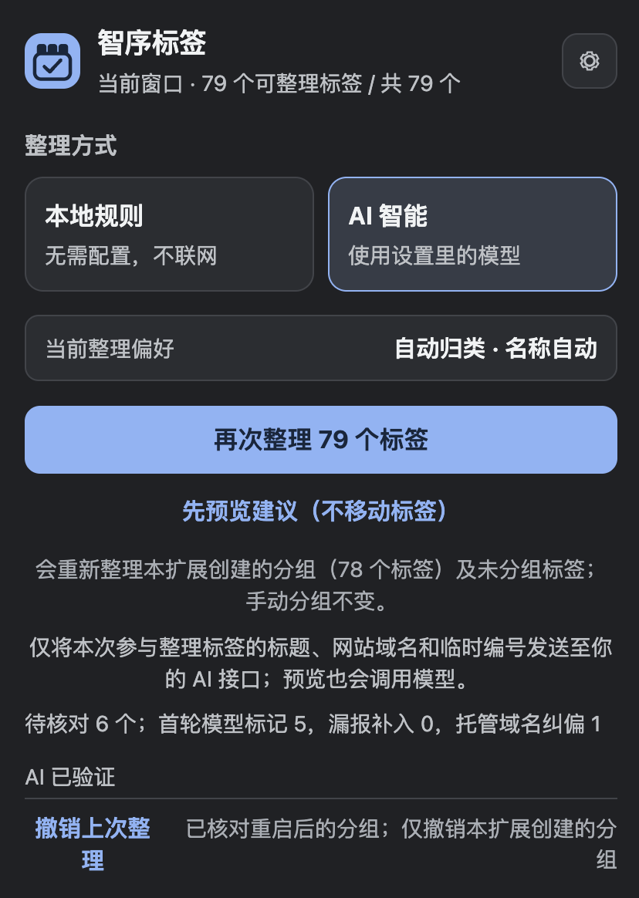
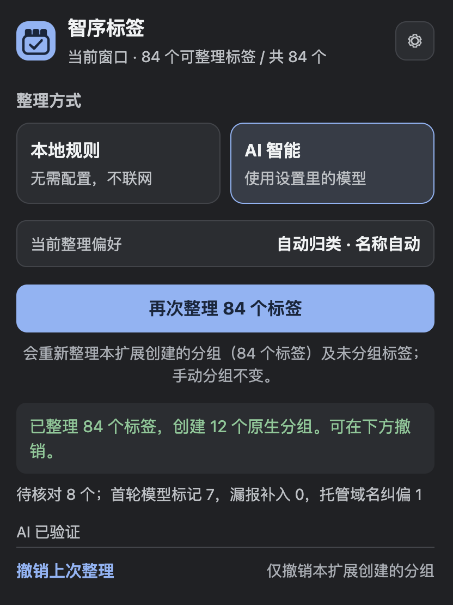
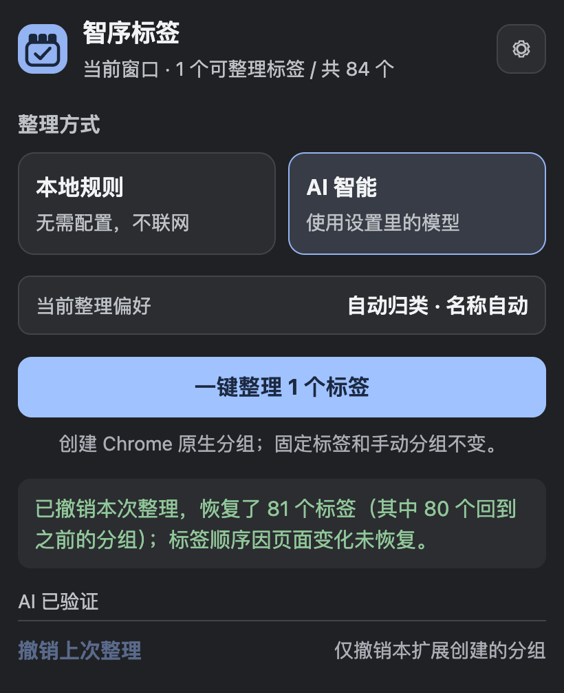
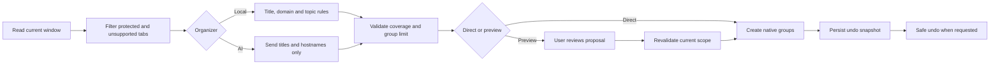

# Smart Tab Organizer 0.13.2

**English** | [简体中文](./README.zh-CN.md)

> Turn dozens of scattered Chrome tabs into native tab groups. Run entirely offline, or connect your own AI endpoint. Preview changes, reorganize new work, and safely undo after a browser restart.


Maintainer: iTang

## The problem is not simply “too many tabs”

Many tab managers solve overload by closing pages, bookmarking them, saving a session, or moving everything into a separate dashboard. That did not match the real workflow behind this project:

- the pages are not needed right now, but will be needed again;
- grouping only by website does not describe a cross-site project or task;
- a single action may move dozens of tabs, so users need a preview and a recovery path;
- new tabs keep appearing, so organization cannot be a one-time operation;
- AI can improve semantic grouping, but the endpoint, privacy, and cost should remain under the user's control;
- Chrome's own tab strip should remain the source of truth.

Smart Tab Organizer therefore uses a deliberately small control surface: **analyze the current window, create native Chrome tab groups, record what changed, and safely undo when possible.**

## Real-world screenshots

The images below were captured during actual 0.13.x development and use. They are not mockups or generated product images. Public documentation excludes API keys, account email addresses, full browsing history, and operating-system usernames.

### Local rules or user-provided AI, with direct action and preview

<p align="center">
  
</p>

This live interface shows the core operating model:

- 79 tabs are eligible in the current window;
- local rules work without configuration or network access;
- AI mode uses the endpoint configured by the user;
- the primary action remains one-click organization;
- “Preview suggestions” does not move tabs;
- groups previously created by the extension can be reorganized with new tabs;
- manually created groups remain untouched in the default scope.

> This screenshot comes from the continuous 0.13.x iteration. Version 0.13.2 further reduced settings-page copy by moving secondary explanations into hover-, focus-, and touch-accessible information controls. The underlying organization behavior did not change.

### 84 tabs organized into 12 native groups

<p align="center">
  
</p>

This was an actual organization run:

- 84 tabs were processed;
- 12 native Chrome groups were created;
- 8 tabs were marked for review;
- an undo path was retained;
- no tab was closed and no page content was modified.

“Review” is not an unexplained fallback. Diagnostics distinguish model-marked uncertainty, omitted tabs restored by validation, hosted-domain correction, and the group-count limit.

### Restart-safe undo restored 81 tabs

<p align="center">
  
</p>

Early builds lost undo state when Chrome exited. Starting with 0.11.0, undo snapshots moved to persistent local storage; 0.12.0 then added multiple history entries and protection for tabs added to an old group later.

The result shown here is intentionally specific:

- 81 tabs were restored by undo;
- 80 returned to their previous groups;
- exact tab order could not be fully restored because page state had changed, so the interface reported that limitation instead of claiming a perfect rollback.

The reliability rule is simple: **undo is enabled only when the previous groups can be identified safely. Ambiguous state is rejected instead of risking damage to manually maintained groups.**

## Feature overview

| Capability | Implementation in 0.13.2 |
|---|---|
| Native Chrome groups | Uses the `tabs` and `tabGroups` APIs; results remain in the browser tab strip |
| Offline organization | Title, domain, repeated project name, and topic heuristics; no network access |
| Optional AI | Compatible with user-selected Chat Completions endpoints and models |
| Two grouping preferences | Topic-oriented automatic grouping or site-first merging |
| Group-name language | Automatic, Chinese, or English while preserving brand and product names |
| Read-only preview | Generates a plan without moving tabs and validates it again before apply |
| Repeat organization | Includes new tabs and extension-owned groups; protects manual groups by default |
| Multiple undo entries | Persists snapshots locally and revalidates them after Chrome restarts |
| Learned corrections | Remembers exact site/title corrections for later automatic grouping |
| Safety filters | Protects pinned tabs, manual groups, split-view tabs, and unsupported pages |
| Non-destructive scope | Never closes tabs and never modifies page content |

## How it works



### Local rules

Use local rules when you want predictable, zero-configuration organization without sending any data to a service. They are particularly effective for site-first grouping, repeated titles, duplicate pages, known project names, and common development topics.

### AI mode

Use AI mode when one project spans several sites, or when natural group names matter more than strict site boundaries. Model output is never applied directly: tab IDs, duplicates, omissions, group limits, hosted-domain mistakes, and overly narrow names are checked or repaired locally first.

### Grouping preferences

| Preference | Best for | Example |
|---|---|---|
| Automatic grouping | Cross-site projects and tasks | Repository, documentation, deployment console, and research pages in one project group |
| Merge same site | Strong site consistency | Bilibili home, search, and message subdomains kept together |

Both modes must cover every eligible tab and create at most 24 groups. Uncertain items go to `Review` or `待核对`.

### Preview safety

- Preview does not move tabs.
- AI preview can still call the configured model and incur cost.
- The eligible tab set, title, and hostname are checked again before apply.
- A stale preview is rejected and must be regenerated.

### Reorganizing later

Version 0.12.0 expanded the scope beyond ungrouped tabs. A later run can include extension-owned groups plus new tabs that Chrome or the user placed inside them. The default scope still protects manual groups, pinned tabs, split-view tabs, and unsupported special pages.

### What undo means

Undo restores **grouping changes**, not a complete browser backup.

- Previous group membership can be rebuilt.
- Tab order is restored when the current state still permits it.
- Closed pages cannot be recreated.
- Chrome can assign new tab and group IDs after restart, so names, colors, known members, and fingerprints must be matched again.
- Ambiguous or changed groups disable undo.

## Installation

1. Download or clone the project.
2. Open `chrome://extensions`.
3. Enable **Developer mode**.
4. Select **Load unpacked**.
5. Choose the directory containing `manifest.json`.
6. Pin Smart Tab Organizer to the toolbar.

Minimum version: Chrome 127.

Default shortcut:

- macOS: `Command + Shift + Y`
- Windows/Linux: `Ctrl + Shift + Y`

The shortcut can be changed at `chrome://extensions/shortcuts`.

## AI configuration

Configure a Chat Completions-compatible API base URL, API key, and model ID in Settings. The endpoint may be a service root, a `/v1` URL, or a full `/v1/chat/completions` URL. A local Ollama endpoint can use `http://127.0.0.1:11434/v1`.

The model-list button attempts to read `/v1/models`. If the provider does not expose model discovery, enter the model ID manually.

## Privacy and data boundaries

### Local mode

- no network access;
- no model call;
- grouping, undo, and learned corrections stay on the device.

### Data sent in AI mode

Only eligible tabs from the active organization scope contribute a page title, hostname, normalized site identifier, and temporary tab ID.

The extension does **not** send full URLs, query parameters, page content, pinned tabs, tabs inside manually protected groups, or the API key itself.

### Data stored locally

- endpoint, model, and key use `chrome.storage.local`;
- settings do not sync through the Chrome account;
- local storage is not an encrypted credential vault;
- undo records store group metadata, title/site features, and SHA-256 URL digests rather than full URLs;
- learned corrections are not sent to the model.

## Permissions

| Permission | Purpose |
|---|---|
| `tabs` | Read current-window state and move tabs into groups |
| `tabGroups` | Create, name, color, and inspect native Chrome groups |
| `storage` | Store preferences, correction memory, and undo snapshots |
| `contextMenus` | Add an “Organize current window” context-menu entry |
| Optional host access | Requested only for the AI endpoint explicitly configured by the user |

## Project structure

```text
chrome-native-tab-organizer/
├── manifest.json       # Manifest V3, permissions, shortcut and entry point
├── background.js       # Window operations, preview, apply, undo and locking
├── core.js             # Local grouping, AI validation and topic repair
├── ai.js               # Endpoint handling, model discovery and requests
├── undo-state.js       # Persistent snapshots and restart-safe matching
├── popup.html          # Popup structure
├── popup.css           # Visual states and layout
├── popup.js            # UI, settings, preview and feedback
├── icons/
├── test/
├── DESIGN.md
└── README.md
```

## Development and verification

No third-party test dependency is required:

```bash
npm test
```

Verified while preparing this documentation:

```text
tests 49
pass  49
fail  0
```

Coverage includes local and AI grouping completeness, the 24-group limit, site coherence, hosted-domain correction, AI data minimization, connection-test isolation, transactional rollback, per-window operation locking, restart-safe undo, repeated organization, and stale-preview rejection.

## Release history

| Version | Key change |
|---|---|
| 0.9.0 | Topic repair, API-service recognition, hosted-page correction |
| 0.10.0 | Duplicate-page grouping, scoped AI review, learned corrections |
| 0.10.2 | Failure rollback, operation locking, safer endpoint authorization |
| 0.11.0 | Persistent AI settings and undo snapshots; stacked transient feedback |
| 0.11.1 | API key show/hide control |
| 0.12.0 | Reorganize extension-owned groups; multiple undo entries |
| 0.13.0 | Strict AI input scope, preview, clearer undo reporting |
| 0.13.1 | Progressive disclosure on the main screen |
| 0.13.2 | Matching settings-page simplification and visible key warning |

## Known limits

- Native Chrome groups cannot span windows; each run affects the current window only.
- Local rules and AI can both misclassify content; preview important windows first.
- Brand and product names are not forcibly translated.
- Undo cannot recover closed pages or guarantee exact positions after unrelated changes.
- Extensions cannot modify Chrome's built-in tab-search menu.
- Version 0.13.2 does not include manual memory release; that capability was added in the later Qiye product line.

## Before publishing

- [ ] Keep this README and the source in the same version directory.
- [ ] Keep the relative `assets/` paths.
- [ ] Add a standalone privacy policy covering AI metadata transmission and local key storage.
- [ ] Choose and add a `LICENSE`; this snapshot does not declare an open-source license.
- [ ] Add support, issue, release, and Chrome Web Store links.
- [ ] Run a clean-profile manual test: install, organize, preview, restart, and undo.

## Screenshot authenticity

- All screenshots come from real extension interfaces and actual organization runs.
- No generative image was used to fabricate product UI.
- The 0.13.x interface changed during iteration, so screenshots document real workflows and outcomes rather than promising pixel-perfect identity with the final 0.13.2 build.
- Images containing account data, API keys, full browsing history, or system usernames were excluded.

