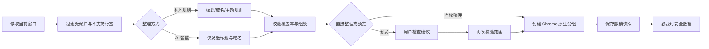

# 智序标签 0.13.2

[English](./README.md) | **简体中文**

> 把几十个散乱的 Chrome 标签整理成真正的原生标签组：可本地运行，也可接入用户自己的 AI；支持预览、再次整理和重启后安全撤销。


维护者：iTang

> [!IMPORTANT]
> 智序标签是一个**仅限非商业用途的源码可用项目**。任何商业使用均须事先获得版权所有者的书面许可，详见[许可证](#许可证)。

## 它解决的不是“标签太多”，而是“标签还要继续用”

很多标签管理工具的答案是：关闭、收藏、保存会话，或者把标签搬到另一个管理页面。

实际使用中的痛点更具体：

- 页面暂时不用，但之后还要继续访问，不能简单关闭；
- 标签来源很多，仅按网站域名分组并不能反映“同一个项目”或“同一个任务”；
- 一次整理可能改动几十个标签，用户必须能够预览和回退；
- 新标签会不断产生，整理不能只做一次；
- AI 分类可能更聪明，但 API、隐私与费用应该由用户自己控制；
- 扩展不能创建一套脱离 Chrome 的“第二标签系统”，结果必须回到 Chrome 原生标签栏。

智序标签 0.13.2 的核心思路是：**Chrome 标签栏仍然是最终界面，扩展只负责分析、创建原生分组、记录操作并在必要时安全撤销。**

## 真实使用截图

以下图片来自 0.13.x 的真实开发与使用过程，不是设计稿，也不是生成图片。为便于公开发布，截图只保留扩展界面，没有包含 API Key、账号邮箱或完整浏览历史。

### 主流程：本地规则与 AI 可选，直接整理或先预览

<p align="center">
  
</p>

这张实机图展示了 0.13.x 的核心操作模型：

- 当前窗口共有 79 个可整理标签；
- 可选择完全离线的本地规则，也可选择用户配置的 AI；
- 默认主动作仍然是一键整理；
- “先预览建议”不会移动标签；
- 已经由扩展创建的旧组可以和新标签一起再次整理；
- 手动创建的分组在默认范围内保持不变。

> 截图来自 0.13.x 连续迭代期。0.13.2 在此基础上继续精简了设置页，将长说明收进可悬停、聚焦或点击的信息提示；业务逻辑未改变。

### 一次整理 84 个标签，创建 12 个 Chrome 原生分组

<p align="center">
  
</p>

这不是模拟数字。该次实际操作完成了：

- 整理 84 个标签；
- 创建 12 个 Chrome 原生标签组；
- 标记 8 个需要人工核对的标签；
- 保留撤销入口；
- 没有关闭标签，也没有修改网页内容。

“待核对”并不是失败兜底的模糊提示。扩展会区分模型主动标记、漏报补入、托管域名纠偏和分组上限等来源，让用户知道哪些结果值得检查。

### 重启后仍能撤销：恢复 81 个标签

<p align="center">
  
</p>

早期版本在 Chrome 退出后会丢失撤销状态。0.11.0 起，撤销快照改为本机持久存储；0.12.0 又增加了多次操作记录和对旧组新增标签的保护。

图中的真实结果是：

- 撤销本次整理，恢复 81 个标签；
- 其中 80 个回到之前的分组；
- 页面变化导致精确顺序未完全恢复，因此界面明确说明，而不是宣称“完全还原”。

这体现了项目的可靠性原则：**能安全恢复才允许撤销；无法唯一识别原分组时宁可禁用，也不冒险拆错用户手动分组。**

## 功能一览

| 能力 | 0.13.2 的实现 |
|---|---|
| 原生标签组 | 使用 Chrome `tabs` 与 `tabGroups` API，结果直接出现在浏览器标签栏 |
| 本地规则 | 无需配置、完全离线，依据标题、域名和主题关键词分类 |
| AI 智能 | 支持兼容 Chat Completions 的自选接口与模型 |
| 两种分类偏好 | “自动归类”允许跨网站按项目/主题组合；“同站合并”优先保持同一网站一致 |
| 组名语言 | 自动、中文或 English；品牌和产品专名保留原文 |
| 预览 | 先生成方案，不移动标签；应用前重新校验标签范围 |
| 再次整理 | 新标签与可安全识别的扩展旧组一起重排；手动分组默认不动 |
| 多次撤销 | 本机保存多份撤销快照；重启后重新核对再恢复 |
| 调整记忆 | 记住用户对扩展分组的纠正，用于以后自动归类 |
| 安全过滤 | 固定标签、手动分组、分屏标签与不支持的页面不参与默认整理 |
| 不关闭标签 | 只改变原生分组关系，不关闭页面、不修改网页内容 |

## 使用流程



### 1. 选择整理方式

**本地规则**适合：

- 不希望联网；
- 不想配置 API；
- 主要需求是同站归并、重复标题整理和常见项目关键词聚合。

**AI 智能**适合：

- 需要跨网站识别同一个项目或任务；
- 希望获得更自然的主题组名；
- 接受向自己选择的接口发送标题与域名，并承担对应费用。

### 2. 选择分类偏好

| 偏好 | 适合场景 | 示例 |
|---|---|---|
| 自动归类 | 同一任务横跨多个网站 | GitHub、部署平台、文档、搜索结果可进入同一项目组 |
| 同站合并 | 首先保证网站一致性 | B 站首页、搜索、消息等子域名优先进入同一组 |

两种模式都要求所有参与标签被覆盖，最多创建 24 组；无法确信的内容会进入“待核对 / Review”。

### 3. 直接整理，或先预览

- “一键整理”直接创建原生分组；
- “预览建议”只生成方案，不移动标签；
- AI 预览仍可能产生模型调用与费用；
- 如果预览后标签范围、标题或域名发生变化，旧方案会被拒绝，必须重新预览。

### 4. 继续工作，再次整理

0.12.0 以后，扩展不仅处理未分组标签，也会重新整理它能够安全识别为自己创建的旧组。Chrome 后来放入旧组的新页面也会进入本次分类。

默认仍保护：

- 用户手动创建的分组；
- 固定标签；
- 分屏标签；
- 不支持分组的特殊页面。

### 5. 不满意就撤销

撤销恢复的是**标签分组变更**，不是完整浏览器备份：

- 可以恢复原分组关系；
- 尽力恢复顺序，但页面变化后可能无法完全一致；
- 不能恢复已经关闭的页面；
- Chrome 重启后分组 ID 会变化，因此必须重新核对名称、颜色和已知成员；
- 如果当前状态与记录无法唯一对应，撤销按钮会禁用。

## 安装

1. 下载或克隆项目。
2. 打开 `chrome://extensions`。
3. 开启“开发者模式”。
4. 点击“加载已解压的扩展程序”。
5. 选择包含 `manifest.json` 的项目目录。
6. 将“智序标签”固定到工具栏。

最低要求：Chrome 127。

默认快捷键：

- macOS：`Command + Shift + Y`
- Windows / Linux：`Ctrl + Shift + Y`

可在 `chrome://extensions/shortcuts` 中修改。

## AI 配置

在设置中填写：

- 兼容 Chat Completions 的 API 基础地址；
- API Key；
- 模型 ID。

地址可以是服务根地址、`/v1` 地址或完整的 `/v1/chat/completions` 地址。本机 Ollama 可使用 `http://127.0.0.1:11434/v1`。

模型输入框旁的列表按钮会尝试读取 `/v1/models`；如果服务商不开放模型列表，也可以手动填写模型 ID。

## 隐私与数据边界

### 本地规则

- 不联网；
- 不调用模型；
- 分类、撤销与调整记忆都在本机完成。

### AI 模式会发送什么

仅发送本次参与整理标签的：

- 页面标题；
- 网站域名；
- 归一化网站标识；
- 临时标签 ID。

不会发送：

- 完整网址；
- 查询参数；
- 网页正文；
- 固定标签；
- 手动分组中的标签；
- API Key 本身。

### 本机保存什么

- API 地址、模型与 Key 保存在 `chrome.storage.local`；
- 不随 Chrome 账号同步；
- Key 不是保存在加密保险箱中，共用设备需谨慎；
- 撤销记录保存分组信息、标题/网站特征与 URL 的 SHA-256 摘要，不保存完整 URL；
- 调整记忆只用于以后分类，不会发给模型。

## 权限说明

| 权限 | 用途 |
|---|---|
| `tabs` | 读取当前窗口标签状态、移动和分组标签 |
| `tabGroups` | 创建、命名、着色和读取 Chrome 原生标签组 |
| `storage` | 保存设置、调整记忆和撤销快照 |
| `contextMenus` | 提供“整理当前窗口的标签页”右键入口 |
| 可选主机权限 | 仅在用户配置 AI 接口并主动连接时请求对应域名访问 |

## 项目结构

```text
chrome-native-tab-organizer/
├── manifest.json       # Manifest V3、权限、快捷键和入口
├── background.js       # 当前窗口操作、预览、应用、撤销与并发保护
├── core.js             # 本地分类、AI 结果校验与主题修复
├── ai.js               # AI 地址处理、模型发现、连接测试与请求
├── undo-state.js       # 撤销快照、重启后匹配与恢复判断
├── popup.html          # 弹窗结构
├── popup.css           # 视觉样式与响应状态
├── popup.js            # 弹窗交互、设置、预览和提示
├── icons/              # 扩展图标
├── test/               # 无第三方测试依赖的 Node 测试
├── DESIGN.md           # 设计约束与交互说明
└── README.md
```

## 开发与验证

无需安装第三方依赖：

```bash
npm test
```

本 README 生成时重新执行了测试：

```text
tests 49
pass  49
fail  0
```

覆盖范围包括：

- 本地与 AI 分类结果完整性；
- 24 组上限；
- B 站子域名一致性；
- 托管域名与 API 服务纠偏；
- AI 不接收固定或手动分组标签；
- 连接测试不发送标签数据；
- 中途失败回滚；
- 同窗口操作互斥；
- 重启后撤销；
- 再次整理后的多层撤销；
- 预览只读与过期方案拒绝。

## 版本演进摘要

| 版本 | 关键变化 |
|---|---|
| 0.9.0 | 增加主题修复、API 服务识别与部署页面纠偏 |
| 0.10.0 | 增加同站重复页聚合、AI 二次复核与手动调整记忆 |
| 0.10.2 | 加固失败回滚、并发互斥和首次接口授权流程 |
| 0.11.0 | API 设置和撤销快照持久化；顶部短时反馈 |
| 0.11.1 | API Key 显示/隐藏按钮 |
| 0.12.0 | 再次整理扩展旧组；多次撤销；保护后来加入旧组的新标签 |
| 0.13.0 | 严格限制 AI 数据范围；增加预览；改进撤销报告 |
| 0.13.1 | 精简主界面长说明，改为按需显示 |
| 0.13.2 | 同步精简设置页；保留 Key 的显式安全提示 |

## 已知边界

- Chrome 原生标签组不能跨窗口，每次只处理当前窗口；
- 本地规则与 AI 都可能误判，重要窗口建议先预览；
- 组名语言是偏好，不会翻译品牌和产品专名；
- 撤销不能恢复已关闭页面，也不能保证变化后的精确位置；
- 扩展不能修改 Chrome 自带的标签搜索菜单；
- 0.13.2 不包含手动释放后台页面的内存管理模块，该能力在后续“栖页”版本中加入。

## 许可证

版权所有 © 2026 iTang。

智序标签依据 [PolyForm Noncommercial License 1.0.0](../../../LICENSE) 提供。在遵守完整许可证条款并保留必要声明的前提下，可以将本项目用于获准的非商业用途，包括使用、学习、修改和再分发。

仓库许可证**不授予商业使用权**，包括用于付费产品或服务、产生收入的部署、商业客户项目以及企业内部业务流程。任何商业使用均须事先获得版权所有者另行出具的书面许可。

本项目属于**源码可用（source-available）**项目，而不是 OSI 认可的开源软件。如果本段摘要与 `LICENSE` 文件存在冲突，以 `LICENSE` 文件为准。

## 公开发布前的仓库清单

- [ ] 将本目录中的 README 与项目源码放在同一仓库根目录；
- [ ] 保留 `assets/` 中的相对图片路径；
- [ ] 增加独立隐私政策，准确说明 AI 标题/域名传输与本机 Key 存储；
- [x] 添加 PolyForm Noncommercial 1.0.0 `LICENSE`，并明确说明本项目属于源码可用项目；
- [ ] 补充问题反馈、支持渠道和 Chrome Web Store 链接；
- [ ] 发布前在干净 Chrome 配置中完成一次安装、整理、预览、重启撤销的人工回归。

## 截图与真实性说明

- 图片均来自真实扩展界面和实际标签整理过程；
- 没有使用生成式图片伪造产品界面；
- 0.13.x 在连续迭代中调整过文案与信息密度，因此图片用于证明真实流程和结果，不保证每个像素与最终 0.13.2 完全一致；
- 公开版主动排除了含账号、API Key、完整浏览历史和系统用户名的截图。
